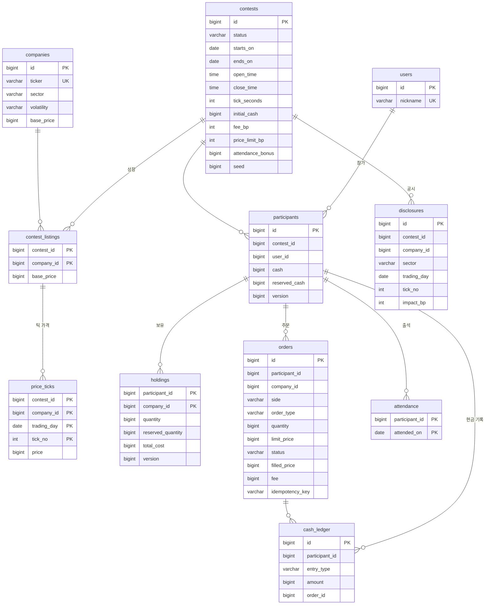

# 03. ERD와 모듈 경계

> 상태: 초안. 실제 스키마는 `src/main/resources/db/migration/V1__init.sql`(Flyway)이고, JPA 엔티티는 이 스키마에 맞춰 직접 작성한다(`ddl-auto: validate`).



## 설계 메모(면접 꼬리질문 대비)

- **잔고를 `participants`에 두는 이유:** 한 사용자가 대회마다 다른 계좌를 가지므로, 잔고는 사용자가 아니라 "대회 참가" 단위다.
- **`version` 컬럼:** 2주차 낙관적 락(`@Version`) 실험용. 비관적 락·조건부 UPDATE 실험에서는 쓰지 않는다.
- **`reserved_cash`/`reserved_quantity`:** 지정가 주문을 넣으면 자금·주식을 묶는다. 묶지 않으면 지정가 주문 여러 개로 가진 돈보다 많이 살 수 있다(I1 위반).
- **`cash_ledger`:** 잔고는 "결과", 원장은 "이유". I5(현금 보존)를 원장 합계로 검증할 수 있다. 원장은 고치지 않고 추가만 한다. 지정가 주문의 묶기·풀기(`cash` ↔ `reserved_cash`)는 총액이 그대로라 원장에 남기지 않는다.
- **`price_ticks` 기본키 `(contest_id, company_id, trading_day, tick_no)`:** "이 종목의 오늘 틱 n번 가격" 조회가 기본키 탐색 한 번으로 끝난다. 4주차 EXPLAIN 실험의 기준점.
- **`orders (participant_id, idempotency_key)` 유니크:** 같은 키가 두 번 들어오면 DB가 두 번째 INSERT를 막는다(I6).
- **`orders (status, trading_day)` 인덱스:** 정산 배치가 "오늘 대기 중인 지정가 주문"만 빠르게 찾기 위함.

## 모듈(패키지) 경계

```
com.jeffkm.mockleague
├─ common      ApiResponse, 예외, 에러 코드, 시간(Clock) 설정
├─ user        사용자(1주차는 X-User-Id 헤더)
├─ contest     대회 생성·상태 전이·참가
├─ company     가상 상장사 조회
├─ price       가격 경로 생성(엔진), 현재가 조회, 공시
├─ account     참가자 계좌·보유·원장 조회
├─ order       주문 접수·체결·취소, 지정가 정산 배치
└─ ranking     총자산 스냅샷·순위 조회
```

규칙: `order`는 `account`의 잔고를 바꾸지만, 다른 패키지가 `account`의 리포지토리를 직접 부르지 않는다. 각 패키지는 Controller → Service → Repository 순서로만 의존한다.
