# 07. 측정 보고서: 그래프를 어떻게 읽었나

시나리오마다 Grafana 그래프를 붙이고, **어디를 보고 → 무엇이 보였고 → 그래서 어떻게 판단했나**를 적는다.
나중에 다시 읽을 때 "이 그래프에서는 이걸 본다"를 바로 떠올릴 수 있게 하는 것이 목적이다.
시나리오 목록과 그래프 띄우는 법은 [docs/06](06-부하-시나리오와-관측.md), 그림 다시 뽑기는 맨 아래.

## 0. 패널 사전: 각 그래프에서 무엇을 보나

| 패널 | 이것만 본다 | 이렇게 보이면 |
|---|---|---|
| p95 응답 시간 (API별) | 선이 **튀는 구간**이 있나, 어느 API 인가 | 한 API 만 튐 → 그 API 의 일(잠금, 쿼리). **모든 API 가 같이 튐** → 서버 전체가 멈칫(CPU, GC, DB) |
| 응답 상태별 초당 수 | 503·5xx 가 **언제 시작**했나 | 몰림과 같은 시각 503 → 과부하로 덜어냄. 5xx → 버그. 409 → 업무상 거절(정상) |
| 커넥션: 사용 중 · 대기 · 최대 | **대기**(노란 선)가 0 보다 커졌나 | 사용 중이 최대(10)에 붙고 대기가 쌓임 → 커넥션 부족. 3초 넘게 기다리면 503 |
| 커넥션 쥐고 있던 시간 p95 | 평소(약 10 ms)보다 길어졌나 | 길어짐 → 트랜잭션 안에서 무언가를 기다림(잠금, 느린 쿼리, **CPU 를 못 받아서**) |
| CPU | 100% 에 **붙어 있나** | 붙어 있으면 다른 그래프의 나쁜 모습이 전부 CPU 탓일 수 있다. 먼저 이걸 지운다 |
| 전체 p50 · p99 · 최대 | p50 과 p99 의 **간격** | p50 은 그대로, p99 만 튐 → 일부 요청만 막힘. 같이 오름 → 전체가 느림 |

**처음 10~30초는 측정 준비다.** k6 가 사용자 1,000명을 만들고 대회에 참가시킨다(초당 150~400건, 응답 201).
CPU·응답 상태 그래프 맨 앞의 큰 봉우리가 이것이다. 지연 패널에서는 준비 요청을 뺐다.

**"최대" 선은 평평하게 보인다.** Micrometer 의 최대값은 "최근 약 2분 동안의 최대"를 계속 들고 있다가 시간이 지나야 내려간다.
순간값이 아니므로, 언제 느렸는지는 p95·p99 선으로 본다.

---

## 1. steady: 평소 트래픽 (기준선)

- **조건**: CloudShell(시드니) → EC2 t3.micro, 2026-11-13 23:18~23:21 KST. 가정 트래픽 1배(주문 30 + 조회 90 TPS), 2분. 왕복 1 ms.
- **k6 결과**: 처리 128.7 req/s, 못 보낸 요청 0. 주문 p95 23.7 ms / p99 90.9 ms, 조회 p95 7.4 ms. 실패 0, 500 0, 불변식 위반 0.

### CPU
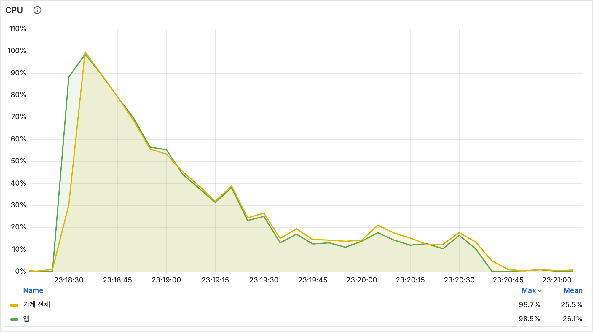

- **본 것**: 처음 98% 에서 1분에 걸쳐 15% 안팎으로 내려간다.
- **판단**: 앞쪽은 준비 단계(사용자 1,000명 만들기)와 JVM 워밍업(자주 쓰는 코드를 기계어로 컴파일하는 중)이다. 본 부하에서는 **CPU 여유가 많다**.

### 커넥션: 사용 중 · 대기 · 최대
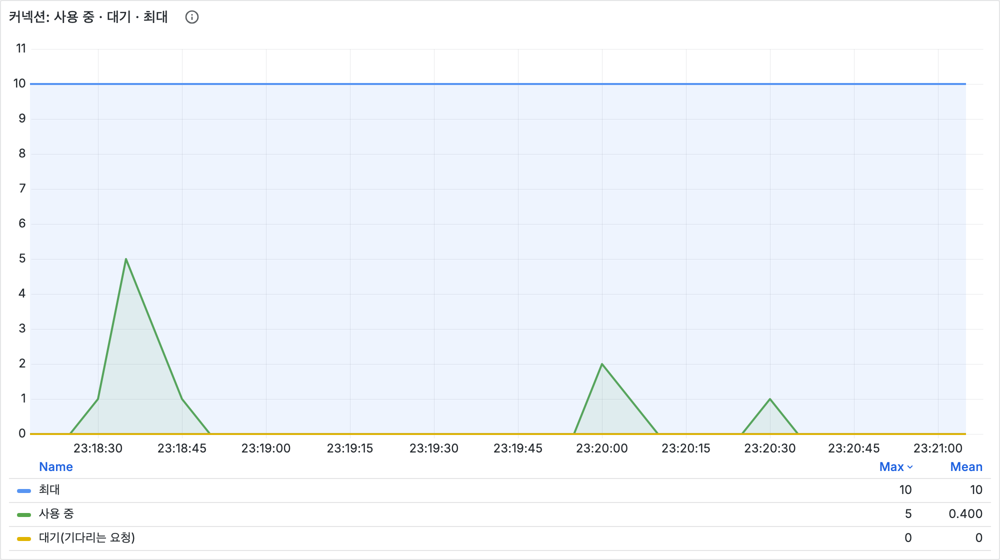

- **본 것**: 사용 중 0~2개(준비 때 5개), 대기는 내내 0.
- **판단**: 풀 10개 중 거의 안 쓴다. 평소 트래픽에서 **커넥션은 병목이 아니다**.

### p95 응답 시간 (API별)
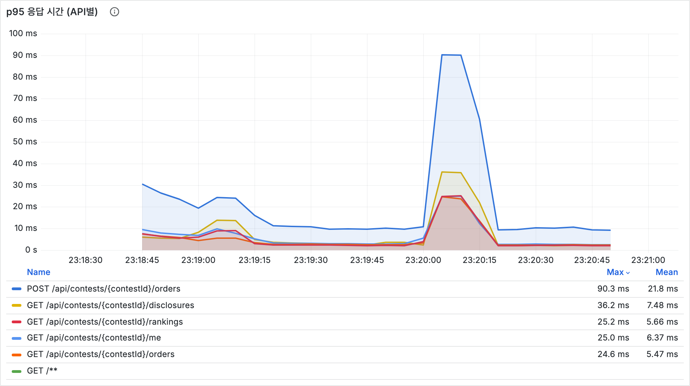

- **본 것**: 주문(파란 선) 약 10 ms, 조회 2~3 ms 로 평평하다. 단, **23:20:05 근처에 모든 API 가 같이** 튀었다(주문 90 ms, 조회 25~36 ms).
- **판단**: 모든 API 가 같은 순간에 튀었으므로 특정 API 의 잠금 문제가 아니라 **서버 전체가 잠깐 멈칫한 것**이다. 같은 시각 GC 멈춤 합이 15초당 12 ms → 35 ms 로 늘었지만, 그것만으로 p95 90 ms 를 설명하기엔 작다. **원인은 확정하지 못했다.** 다음 측정에서 RDS CPU(CloudWatch)와 GC 를 같이 본다.

### 전체 p50 · p99 · 최대
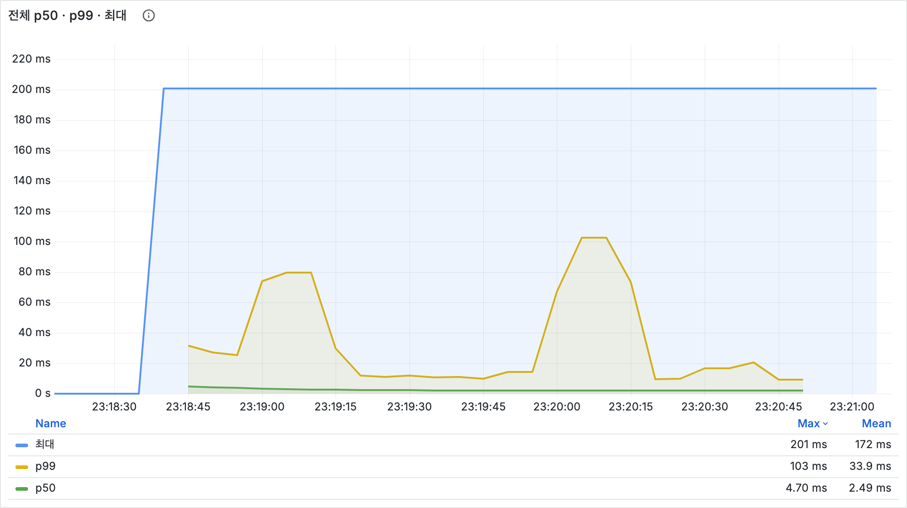

- **본 것**: p50 은 2~5 ms 로 내내 바닥, p99 만 두 번(23:19:05, 23:20:05) 80~100 ms 로 오른다.
- **판단**: 대부분의 요청은 빠르고, 짧은 순간에 일부만 느렸다. 평소 트래픽의 기준선은 **p50 2~3 ms, p99 10~20 ms, 가끔 100 ms 안쪽의 튐**이다.

### 커넥션 쥐고 있던 시간 p95
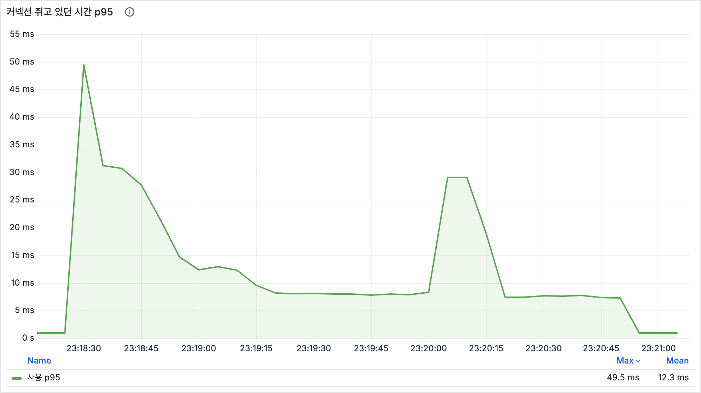

- **본 것**: 평소 약 8 ms. 23:20:05 에 29 ms.
- **판단**: 위의 "모두 같이 튐"과 같은 시각이다. 그 순간에는 트랜잭션 하나하나가 길어졌다는 뜻이다(잠금이라면 주문만 길어져야 한다).

---

## 2. hot: 계좌 5개로 몰림·연타·재전송

- **조건**: CloudShell → EC2, 2026-11-14 00:07~00:09 KST. 주문 30 TPS 를 **계좌 5개, 인기 종목 3개**에 집중. 15% 는 같은 키 동시 두 번(연타), 15% 는 같은 키 늦은 재전송.
- **가설(P1)**: 같은 계좌의 주문은 계좌 행 잠금(`SELECT ... FOR UPDATE`)을 기다린다. 기다리는 동안 커넥션을 쥐고 있어 풀 10개가 바닥나고, 3초 뒤 503 이 난다.
- **k6 결과**: 주문 p95 11.8 ms, 실패 0, 503 0, 500 0. 409 40건(전부 `INSUFFICIENT_QUANTITY`: 아직 주식이 없는 계좌의 매도). 같은 키 → 다른 주문 0, 불변식 위반 0.

### 커넥션: 사용 중 · 대기 · 최대
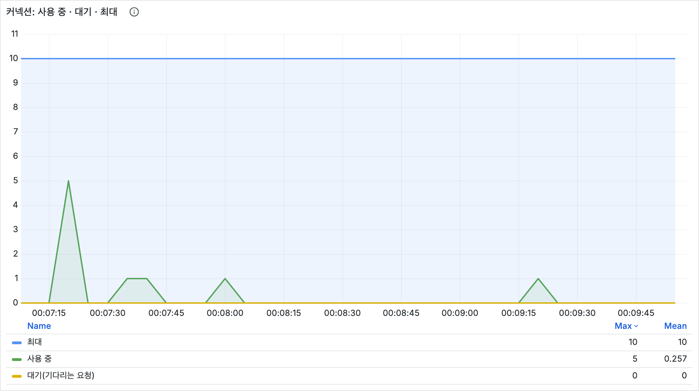

- **본 것**: 사용 중 대부분 0~1(준비 때 5), **대기 0**.
- **판단**: 가설대로라면 사용 중이 10 에 붙고 대기가 올라가야 한다. **둘 다 일어나지 않았다.**

### 커넥션 쥐고 있던 시간 p95
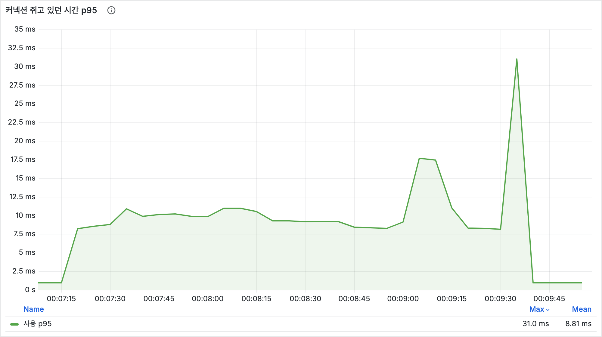

- **본 것**: 약 10 ms 로 평평.
- **판단**: 주문 하나가 잠금·커넥션을 약 0.01초만 쥔다. 계좌 5개에 초당 30건이면 한 계좌에 초당 6건, 잠금이 겹칠 확률이 낮다. **이 부하는 가설을 시험하기에 약했다.**

### p95 응답 시간 (API별)
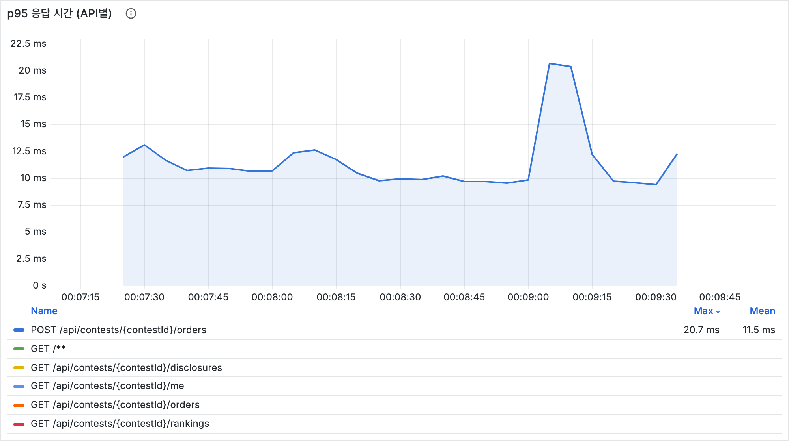

- **본 것**: 주문만 보인다(이 시나리오는 주문만 보낸다). 10~13 ms, 00:09:05 에 한 번 20 ms.
- **판단**: 기준 300 ms 의 4%. 한 번의 튐은 steady 와 같은 "서버 전체 멈칫"과 비슷한 크기다.

### CPU · 응답 상태
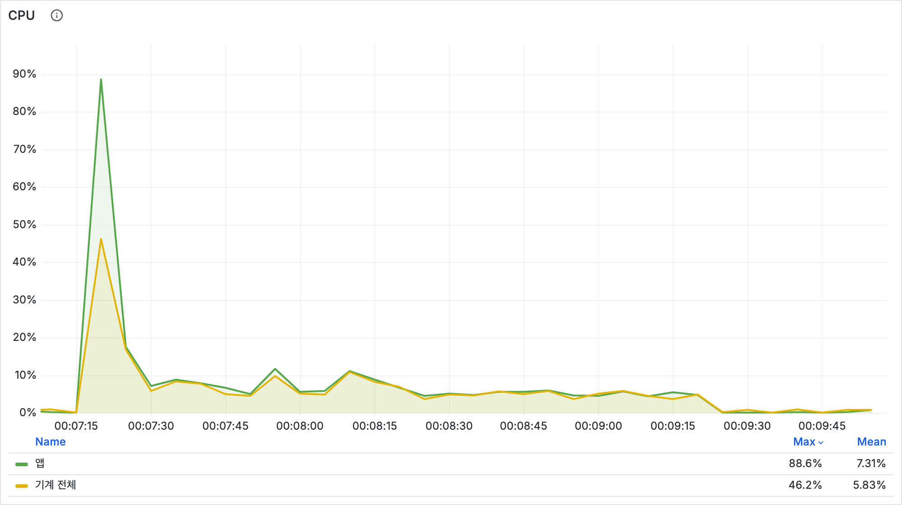
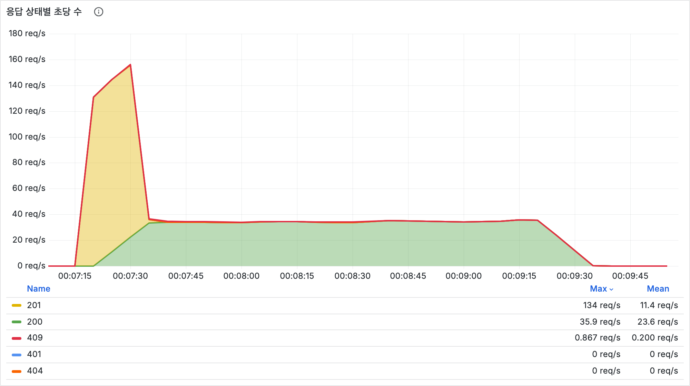

- **본 것**: 준비 단계 뒤 CPU 5~10%. 응답은 200(초당 약 35건) 하나로 평평, 503 없음.
- **판단**: 서버는 이 부하를 거의 힘들이지 않고 처리했다.

---

## 3. 비교: 같은 hot, 로컬(과부하 맥)에서는 왜 503 이 났나

24단계에서 같은 시나리오를 노트북 Docker 로 돌렸을 때는 503 이 278건 났고, 그래프도 가설과 똑같아 보였다.

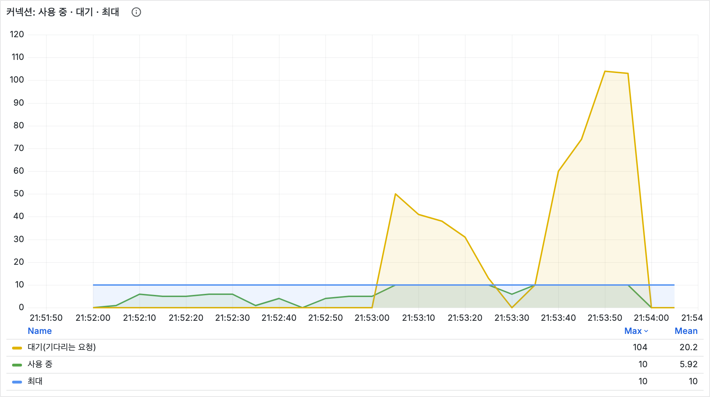
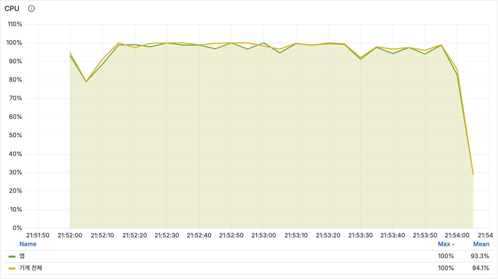

- **본 것**: 커넥션 대기가 최대 104 까지 쌓였다(21:53:05 부터). 그런데 **CPU 는 그보다 50초 먼저(21:52:15) 100% 에 붙어** 끝까지 내려오지 않았다. 그때 맥의 load average 는 200 을 넘었다(Unity 에디터와 다른 컨테이너가 함께 돌았다).
- **판단**: 순서가 "CPU 100% → 트랜잭션이 CPU 를 못 받아 길어짐 → 커넥션을 오래 쥠 → 대기 → 503"이다. 잠금이 먼저가 아니었다. **커넥션 대기 그래프만 봤다면 잠금 문제로 잘못 판단했을 것이다.** 점검표 ③(CPU)을 먼저 지워야 하는 이유가 이것이다.
- **같은 부하, CPU 여유가 있는 서버(2절)에서는 503 이 0** 이었다. 로컬의 503 은 기계 탓이었다.

---

## 4. hot (한 계좌 몰림): 질문과 답으로 읽기

- **조건**: CloudShell → EC2, 2026-11-14 00:49~00:51 KST. `HOT_USERS=1`, 가정의 3배 → **한 계좌에 주문 초당 약 100건**, 1분. 연타·재전송 포함.
- **왜 이렇게 했나**: 2절(계좌 5개, 초당 30건)은 잠금이 겹치지 않아 가설을 시험하지 못했다. 한 계좌에 몰아 잠금이 실제로 줄을 서게 했다. 매크로·봇 하나가 한 계좌로 주문을 쏟는 상황이다.
- **k6 결과**: 주문 p50 7.3 ms, p95 18.3 ms, **p99 343.7 ms, 최대 877.6 ms**. 실패 0, 503 0, 500 0. 409 2,721건(현금 부족 2,398 + 수량 부족 323). 같은 키 → 다른 주문 0, 불변식 위반 0.
- 표에서 이미 보이는 것: p95 는 낮은데 p99 가 2절(34 ms)의 10배다. **대부분은 빠르고 일부만 크게 느렸다.** 그 "일부"가 언제, 왜였는지를 그래프에서 찾는다.

### 질문 1. p99 가 튀는 시각이 있나?
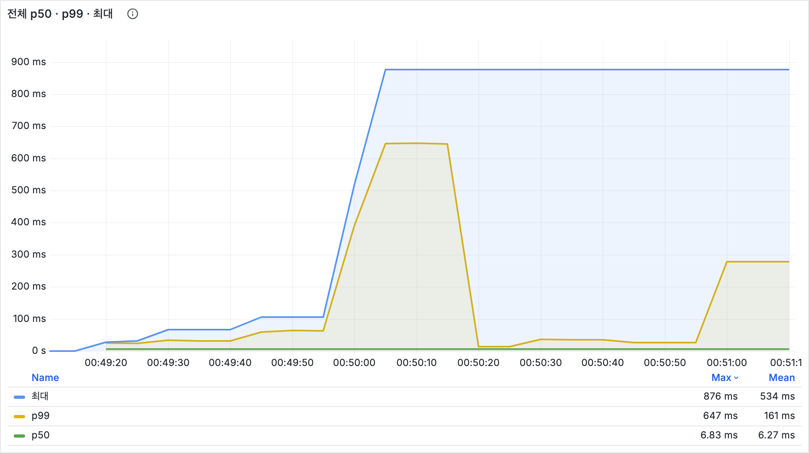

**답**: 있다. **00:50:00 ~ 00:50:15**, p99 가 60 ms 에서 **647 ms** 로 올랐다(최대 876 ms). 00:51:00 에도 작게(280 ms) 한 번 더. 그동안 **p50 은 6~7 ms 그대로**다.
→ 서버 전체가 느려진 것이 아니라 **일부 요청만 막혔다**(패널 사전: p50 그대로, p99 만 튐).

### 질문 2. 그 시각 커넥션 대기는? 사용 중은?
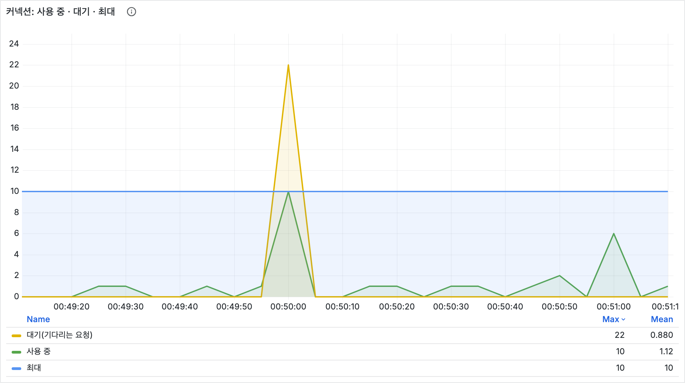

**답**: 00:50:00 에 **사용 중이 최대 10 에 닿았고, 대기가 22** 까지 올랐다. 5초 뒤 0 으로 돌아왔다. 같은 순간 톰캣 작업 스레드도 1~2개 → **32개**로 늘었다(요청이 처리되지 못하고 쌓였다).

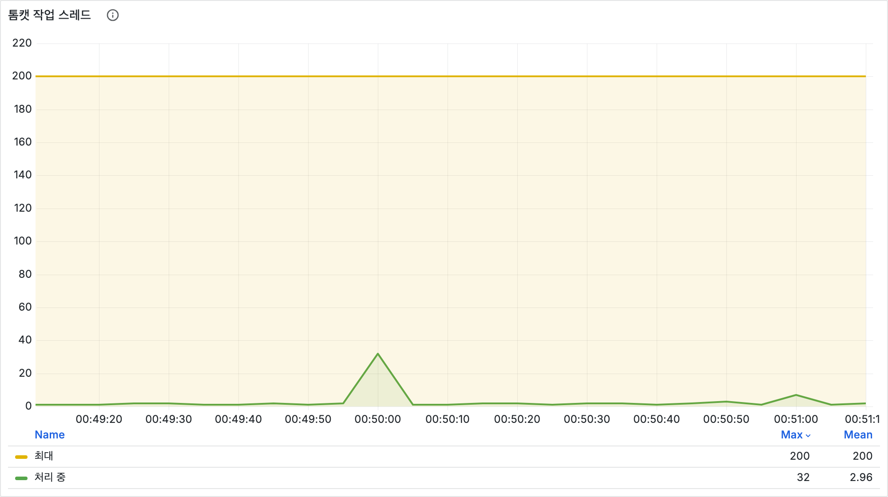

### 질문 3. 커넥션을 "얻는 시간"과 "쥐고 있던 시간", 둘 다 길어졌나?
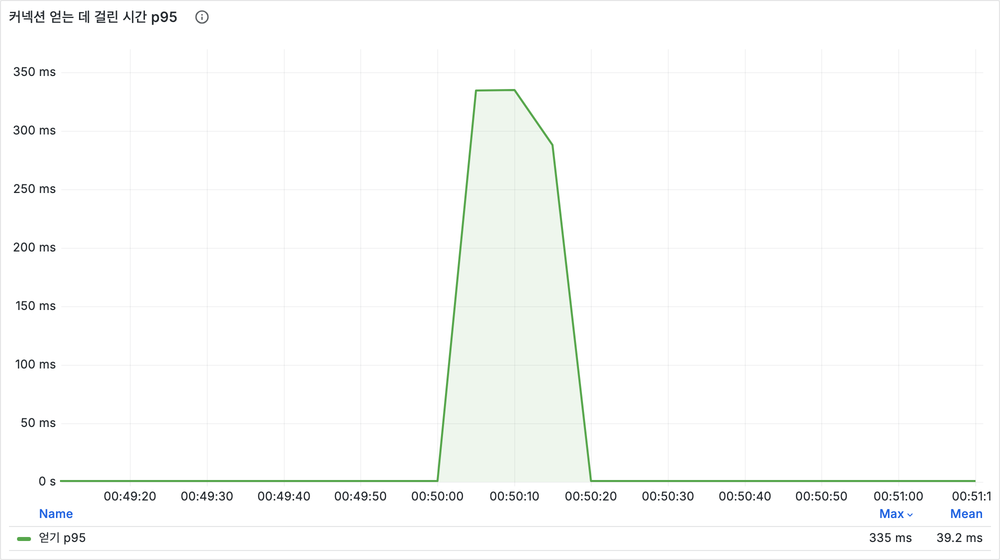
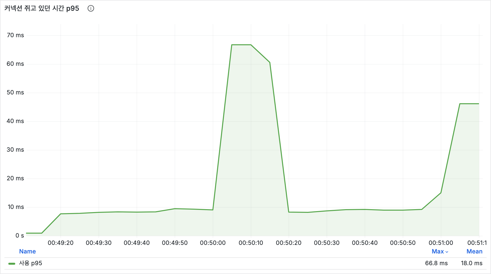

**답**: 둘 다 길어졌다. 얻는 시간 p95 **0 → 335 ms**, 쥐고 있던 시간 p95 **9 → 67 ms**.
→ "쥐고 있던 시간"이 먼저 길어졌기 때문에 "얻는 시간"이 길어진 것이다. 풀이 작아서가 아니라 **트랜잭션 안에서 무언가를 기다리느라 커넥션을 오래 쥐었다.**

### 질문 4. 그 순간 CPU 는?
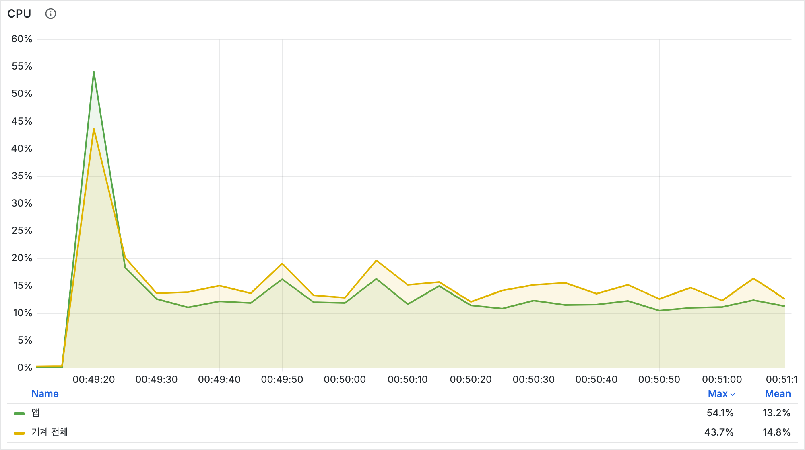

**답**: **12~16%**. 준비 단계(54%) 뒤로 내내 낮다. 로컬(3절)처럼 100% 에 붙지 않았다.
→ CPU 부족이 아니다. 3절과 결정적으로 다른 점이다.

### 질문 5. 합치면 24단계 가설(잠금 대기 → 커넥션을 쥠 → 풀 고갈)과 맞나?

**답: 맞다. 이번에는 가설의 모습이 CPU 와 섞이지 않고 나왔다.**

| 가설이 맞다면 보여야 할 것 | 본 것 |
|---|---|
| CPU 는 낮다 | 12~16% |
| 커넥션을 쥐는 시간이 길어진다 | 9 → 67 ms (p95) |
| 사용 중이 최대에 닿고 대기가 쌓인다 | 10/10, 대기 22 |
| 일부 요청만 느리다 | p50 7 ms 그대로, p99 647 ms |

코드로 확인한 이유: 주문은 **가장 먼저 계좌 행을 잠그고**(`findForUpdate`), 그 뒤에 멱등 확인·현금 확인을 한다(`OrderService.placeOrder` 0단계).
한 계좌로 온 주문은 모두 이 잠금 앞에 줄을 선다. 줄을 서는 동안 각 요청은 이미 커넥션을 하나씩 쥐고 있다.
앞 트랜잭션 하나가 조금만 늦어져도 뒤에 선 요청들이 커넥션 10개를 모두 차지하고, 잠금과 상관없는 요청까지 커넥션을 못 얻는다.

**3절(로컬)과의 차이**: 로컬은 "CPU 100% → 모두 느려짐 → 커넥션을 오래 쥠"이었고, 이번은 "한 계좌 잠금 줄 → 커넥션을 오래 쥠"이다. **대기 그래프는 둘 다 똑같이 생겼다.** CPU 그래프가 둘을 가른다.

### 덧붙인 질문. 현금 부족 거절 2,398건은 측정에 어떤 영향을 줬나?

**답**: 한 계좌에 초당 약 50건씩 매수가 들어오니 초기 현금(1,000만 원)이 몇십 초 만에 바닥났다. 그 뒤 매수는 대부분 409 로 거절됐다.
그런데 현금 확인은 **잠금을 잡은 뒤**에 하므로, 거절될 주문도 똑같이 줄을 서고 잠금을 잡는다. 즉 거절이 많아도 잠금 경합은 줄지 않는다.
다만 거절된 트랜잭션은 주문·원장을 쓰지 않아 짧다. **그래서 이번 측정은 "실제로 체결되는 주문"만 몰릴 때보다 잠금을 짧게 쥔 쪽(낙관적인 쪽)이다.**
→ 다음에 같은 실험을 할 때는 계좌 현금을 넉넉히 주거나 매수·매도를 번갈아 보내 체결 비율을 맞춘다.

### 왜 정확히 그 순간이었나 → 5절에서 추적

계좌 하나에 초당 100건이 1분 내내 들어왔는데, 줄이 길어진 것은 **00:50:01 과 00:51:01, 매분 1초 무렵**뿐이었다.
1절(23:19:05, 23:20:05)과 2절(00:09:05)의 "모든 API 가 같이 튐"도 매분 같은 자리에 있었다. 다음 절에서 원인을 좁혀 간다.

---

## 5. 매분 튐 추적: 가설을 하나씩 지우기

**출발점**: 세 측정 모두 시작 시각이 달랐는데(23:18:28, 00:07:18, 00:49:21), 튐은 늘 **실제 시계로 매분 58초~3초**였다.
→ 측정이 아니라 서버나 DB 쪽에서 **매분 무언가가 일어난다.** 그리고 늘어난 것은 "커넥션 쥐고 있던 시간", 즉 트랜잭션 안에서 보낸 시간이다.

### 가설 1. PostgreSQL autovacuum (기각)

로컬 DB 는 autovacuum 이 1분마다 깨어나고, 실제로 21:52:10, 21:53:10, 21:54:10 에 돌았다. 그럴듯했다. 서버에서 RDS 를 직접 조회했다(`deploy/psql.sh -f /sql/autovacuum.sql`).

| 항목 | 로컬 | RDS |
|---|---|---|
| `autovacuum_naptime` | 1min | **15s** |
| 측정 중 마지막 vacuum·analyze | 매분 :10 | 00:49:22, 00:50:37, 00:51:07, 00:51:22 |

튐(00:50:01, 00:51:01)과 시각이 맞지 않는다. **로컬 기본값만 보고 결론을 냈다면 틀렸다.** 운영 DB 의 설정은 직접 확인해야 한다.

### 가설 2. DB 가 그 순간 바빴다 (기각)

부하를 거는 동안 1초마다 DB 세션이 무엇을 기다리는지 찍었다(`deploy/sql/activity.sql`, KST).

| 시각 | 일하는 세션 | 행 잠금 대기 | 디스크 대기 | 내부 잠금 | autovacuum | RDS 관리 접속 |
|---|---|---|---|---|---|---|
| 02:13:57~59 | 0 | 0 | 0 | 0 | 0 | 0 |
| **02:14:00~02** | 4~10 | **4~9** | 0~1 | 0 | 0 | 0 |
| 02:14:03~04 | 0 | 0 | 0 | 0 | 0 | 0 |
| **02:15:00~03** | 9~10 | **9** | 0 | 0 | 0 | 0 |
| 02:15:04 | 0 | 0 | 0 | 0 | 0 | 0 |

- 정각에 **세션 9개가 행 잠금(`Lock:transactionid`, `Lock:tuple`)을 기다렸다.** 커넥션 10개 중 9개가 한 계좌 행 앞에 줄을 섰다.
- 같은 순간 디스크·내부 잠금·autovacuum·RDS 관리 접속은 **모두 0**. DB 는 바쁘지 않았다.
- 그렇다면 잠금을 쥔 트랜잭션은 DB 안에서 아무것도 기다리지 않았다. **앱이 다음 SQL 을 보내지 않고 멈춰 있었다.** 원인은 DB 바깥(앱 또는 EC2)이다.

### 가설 3. EC2 의 1분 주기 예약 작업 (기각)

`systemctl list-timers` 에 1분마다 도는 작업이 하나 있었다: `refresh-policy-routes@ens5.timer`(네트워크 경로 갱신).
그러나 실행 기록(`journalctl`)은 **17:13:33, 17:15:06 UTC** 였고 17:14 에는 돌지 않았다. 튐(17:14:00~02, 17:15:00~03 UTC)과 맞지 않는다.

### 가설 4. 가상화 계층이 CPU 를 가져간다 (확인)

`vmstat -t 1` 로 1초마다 CPU 를 찍었다. `st`(steal)는 **이 가상 서버가 CPU 를 쓰려 했는데 AWS 하이퍼바이저가 그 시간을 다른 데 준 비율**이다.

| 시각(UTC) | 부하 중 st | 쉴 때 st |
|---|---|---|
| :58~:59 | 0 | 0 |
| **:00** | 3~7 | 1~2 |
| **:01** | **16~22** | 2 |
| **:02** | **16~20** | 3~4 |
| :03~:04 | 0 | 0 |

- **매분 0~2초에만** CPU 를 빼앗긴다. 부하가 없어도 일어나고(1~4%), 부하 중에는 쓰려는 CPU 가 많으니 더 크게(16~22%) 보인다.
- 스왑(`si`·`so`)과 디스크 대기(`wa`)는 0. 메모리·디스크 문제는 아니다.

**결론**: 이 EC2(t3.micro, CPU 를 다른 서버와 나눠 쓰는 버스트형)가 올라간 호스트는 매분 정각 무렵 2~3초 동안 CPU 일부를 가져간다.
그 순간 잠금을 쥔 트랜잭션의 스레드가 CPU 를 못 받아 수십~수백 ms 늦어지고, **한 계좌 줄에 선 요청들이 그동안 커넥션을 쥐고 기다리면서 풀 전체로 번진다.**
왜 하필 매분 정각인지는 AWS 내부 동작이라 여기서 더 확인할 수 없다.

### 그래서 무엇을 고치나

CPU 를 잠깐 빼앗기는 일은 우리가 막을 수 없다. 비싼 인스턴스로 옮겨도 GC, 다른 프로세스, 네트워크 지연처럼 **짧은 멈춤은 어디서나 생긴다.**
문제는 짧은 멈춤 자체가 아니라, 그것이 **한 계좌 잠금 줄 때문에 커넥션 9개로 번진다**는 점이다. 그러니 고칠 곳은 줄이 길게 생기지 않게 하는 쪽이다.

---

## 6. 지금까지의 결론과 다음 측정

| | 결론 |
|---|---|
| 평소 트래픽(steady) | 문제없음. p50 2~3 ms, p99 대부분 20 ms 안쪽. CPU 15% 안팎, 커넥션 대기 0 |
| 계좌 5개 몰림(hot) | 문제없음. 503 0, 연타·재전송 중복 0, 장부 위반 0 |
| P1 가설(잠금 대기 → 풀 고갈) | 계좌 5개(초당 30건)에서는 재현 안 됨. **한 계좌 초당 100건에서 확인**(4절): CPU 12~16% 인데 커넥션 10/10, 대기 22, p99 647 ms. 3초 안에 풀려 503 은 0 |
| 매분 1초 무렵의 튐 | **AWS 하이퍼바이저가 매분 0~2초에 CPU 를 가져간다(steal 16~22%).** autovacuum·DB 부하·예약 작업은 기각(5절). 한 계좌 줄에서는 이것이 대기 22 로 번졌다 |

**다음: 고친 것과 재측정 계획**

한 계좌 줄을 짧게 만드는 방법 세 가지 중 **사용자별 주문 속도 제한**을 골랐다(`order/OrderRateLimiter`).

| 후보 | 고르지 않은/고른 이유 |
|---|---|
| (a) 잠금 대기에 시간 제한(`lock_timeout`) | 줄이 생긴 뒤에 끊는다. 줄 자체는 생기고, 끊긴 요청은 실패로 보인다 |
| (b) 앱에서 계좌별로 줄 세우기 | 커넥션은 아끼지만 서버 한 대에서만 맞고, 초당 100건을 결국 다 처리하려 든다 |
| **(c) 사용자별 속도 제한** | **사람이 낼 수 없는 속도를 커넥션을 잡기 전에 429 로 돌려보낸다.** 줄이 길어질 수 없다. 서비스 규칙으로도 자연스럽다 |

- 한도: 사용자당 초당 5건, 한 번에 최대 10건(연타·재전송 몇 건은 받아 준다). 운영 설정에서 `ORDER_RATE_LIMIT`·`ORDER_RATE_BURST` 로 바꾼다.
- 한 번에 하나만 바꾼다. (a)를 같이 넣으면 재측정에서 무엇이 효과를 냈는지 가를 수 없다.
- 한계: 기록이 서버 메모리에 있어, 서버가 여러 대면 대수만큼 한도가 커진다. 그때는 Redis 같은 공용 저장소로 옮긴다.

**재측정에서 확인할 것** (같은 조건: 한 계좌 초당 100건, 1분)
1. 대부분 429 로 돌아가고, 받아들인 주문의 p99 가 4절(344~757 ms)보다 내려가는가
2. 매분 정각(CPU 를 빼앗기는 순간)에 커넥션 대기·행 잠금 대기가 더는 9개로 번지지 않는가(`activity.sql`)
3. 평소 트래픽(steady)은 그대로인가(사용자 1,000명이 나눠 보내므로 한도에 걸리지 않아야 한다)
4. 불변식 위반 0, 같은 키 → 다른 주문 0

---

## 7. 고친 뒤 재측정 (2026-11-14 03:23, 같은 조건)

조건은 4절과 같다: CloudShell → EC2, 한 계좌에 주문 초당 약 100건, 1분, 연타·재전송 포함. 바뀐 것은 사용자별 속도 제한(초당 5건, 최대 10건) 하나다.

| | 고치기 전 (4절, 두 번) | 고친 뒤 |
|---|---|---|
| 받아들인 주문 | 대부분(현금 부족 거절 2천여 건 제외) | 약 450건, 나머지 **약 95% 는 429** |
| 받아들인 주문의 p99 (서버 측정) | 344 ~ 757 ms (k6, 거절 포함) | **126 ms** (p50 10 ms) |
| 커넥션 대기(pending) 최대 | **22 ~ 30** | **0** |
| 커넥션 사용 중 최대 | 10 / 10 | 6 / 10 |
| 정각의 행 잠금 대기 세션 (`activity.sql`) | **9** | **0** (03:24:00, 03:25:00, 03:26:00 모두) |
| 500 · 불변식 위반 · 같은 키 → 다른 주문 | 0 · 0 · 0 | 0 · 0 · 0 |

- **줄이 사라졌다.** 매분 정각에 세션 9개가 한 계좌 잠금 앞에 서던 모습이 0 이 됐다. 커넥션 대기도 0.
- **CPU 를 빼앗기는 일 자체는 그대로다.** 커넥션 쥔 시간 p99 는 여전히 매분 :59~:04 에 240~335 ms 로 튄다(트랜잭션 하나하나가 그 순간 늦어진다). 다만 이제 뒤에 줄 선 요청이 없으니 **번지지 않는다.** 고치려던 것은 "멈춤"이 아니라 "번짐"이었다.
- 거절된 요청은 1~2 ms 만에 돌아갔다(k6 주문 p50 1.3 ms). DB 커넥션을 잡기 전에 끊기 때문이다.

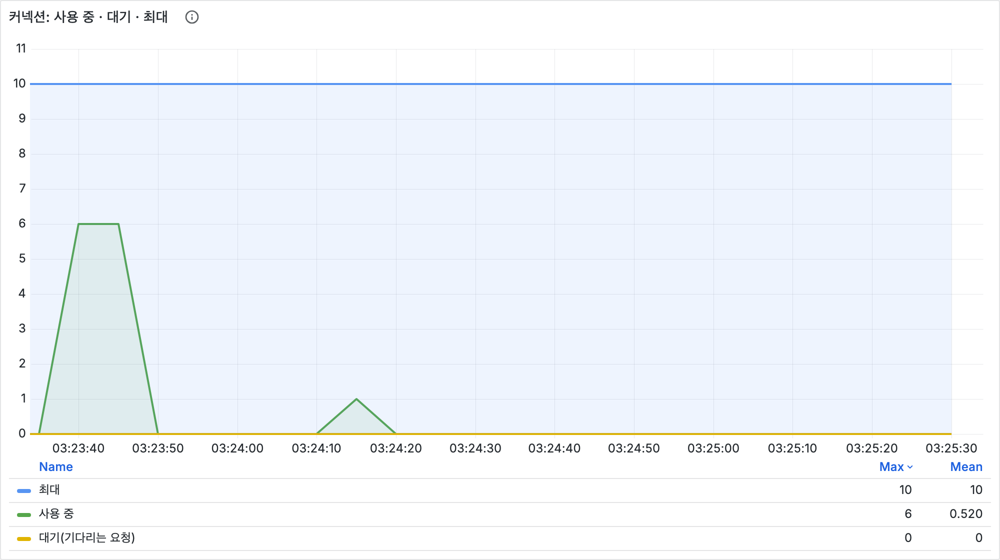
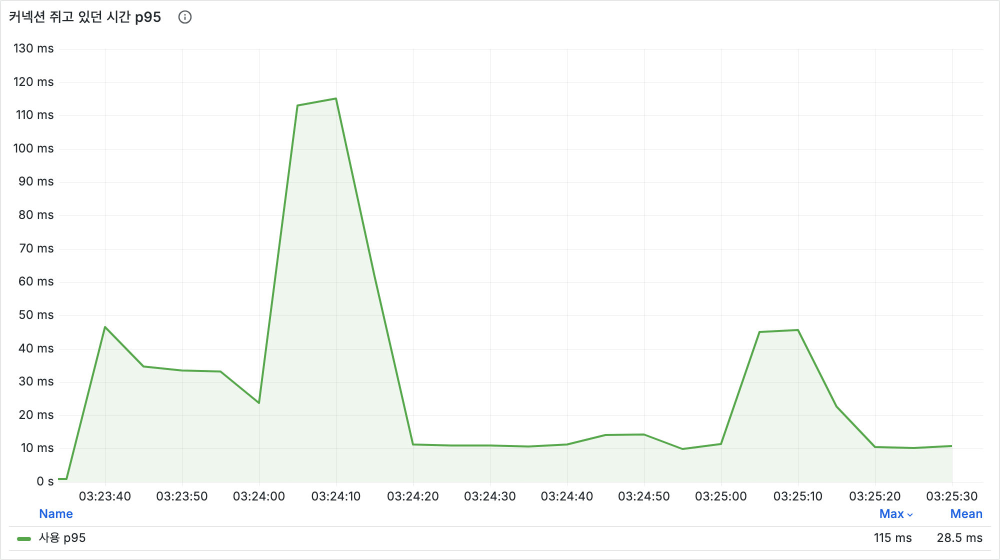

- 위: 커넥션 사용 중 최대 6(측정 준비 때), 본 부하 중에는 0~1. **대기는 내내 0** (4절 그림의 대기 22 와 비교).
- 아래: 쥔 시간 p95 는 매분 정각 무렵(03:24:05 115 ms, 03:25:05 46 ms) 여전히 튄다. CPU 를 빼앗기는 일은 그대로이고, 번지지 않을 뿐이다.

### 평소 트래픽(steady)은 그대로인가

| | 1절 (고치기 전) | 고친 뒤 |
|---|---|---|
| 처리량 · 실패 · 429 | 128.7 req/s · 0 · - | 133.0 req/s · 0 · **0** |
| 주문 p50 / p95 / p99 | 8.8 / 23.7 / 90.9 ms | 8.4 / 18.4 / **192.3** ms |
| 조회 p50 / p95 / p99 | 3.0 / 7.4 / 29.0 ms | 2.9 / 6.7 / **75.4** ms |
| 커넥션 대기 최대 | 0 | 0 |

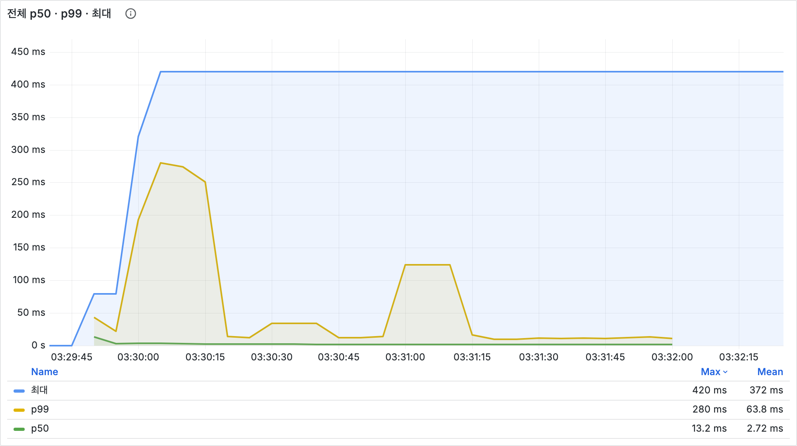

- 그림: p50 은 2~3 ms 로 바닥, p99 만 03:30:00~03:30:15(280 ms)와 03:31:00~03:31:10(124 ms)에 튄다. 둘 다 매분 정각이다.
- 속도 제한에 걸린 요청은 **0건**이다. 사용자 1,000명이 나눠 보내므로 한 사람당 초당 0.03건이다.
- p50·p95 는 같거나 조금 낫다. **p99 는 나빠졌다.** 서버 쪽 p99 를 5초 단위로 보면 50 ms 를 넘은 곳은 **03:30:00, 03:30:05, 03:31:00** 뿐이었다. 모두 매분 정각, CPU 를 빼앗기는 자리다.
- 그래서 p99 차이는 속도 제한 때문이 아니라 **그 순간 빼앗긴 양이 실행마다 달라서**로 본다(1절 때도 같은 자리에서 80~100 ms 로 튀었다). 속도 제한이 하는 일은 사용자별 지도(Map)에서 숫자 하나를 꺼내 빼는 것뿐이고, 이번 실행에서는 한 번도 거절하지 않았다.
- **남은 한계**: 매분 정각의 CPU steal 은 t3(버스트형) 위에서는 피할 수 없다. 모든 요청의 p99 를 100 ms 아래로 묶어야 한다면 CPU 를 나눠 쓰지 않는 인스턴스(m·c 계열)로 옮기는 비용과 비교해 정한다. 지금 목표(p95 300 ms)는 넉넉히 만족한다.

### 정리: 이 사례에서 한 일

1. **현상**: 한 계좌에 초당 100건을 보내자 p99 가 344~757 ms, 최대 1.5초. 커넥션 10/10, 대기 22.
2. **분석**: CPU 는 12~16% 로 낮았다 → CPU 부족이 아니다(로컬에서 본 503 과 구별). 매분 같은 자리에서 튐 → autovacuum·DB 부하·예약 작업을 차례로 기각 → **하이퍼바이저 CPU steal(매분 0~2초)** 확인. 그 순간 늦어진 트랜잭션 하나가 한 계좌 잠금 줄을 따라 커넥션 풀 전체로 번졌다.
3. **해결**: 멈춤은 못 막으니 번짐을 끊는다. 사람 속도를 넘는 주문을 커넥션을 잡기 전에 429 로 돌려보낸다(사용자별 토큰 버킷).
4. **재측정**: 같은 조건에서 커넥션 대기 22 → 0, 정각의 잠금 대기 세션 9 → 0, 받아들인 주문 p99 126 ms. 평소 트래픽은 거절 0건.
5. **불변식**: 전후 모두 위반 0, 같은 키 → 다른 주문 0.

## 8. P3 틱 경계 캐시 스탬피드 (2026-11-14 15:34~15:58, EC2)

### 무엇을 의심했나

가격·순위 캐시는 키에 버전(틱, 스냅샷 id)을 넣어 무효화를 없앴다. 대신 **틱이 바뀌는 순간 키가 한꺼번에 바뀐다**. 그때 동시에 들어온 요청이 모두 캐시를 놓치면 같은 쿼리를 각자 DB 에서 읽는다(캐시 스탬피드). 동시에 놓치는 수는 대략 "초당 요청 수 × 한 번 읽는 시간"이다.

### 재기 위해 만든 것

- **시계를 고정하면 틱이 바뀌지 않아 재현이 안 된다.** 그래서 5배속 시계(`LEAGUE_CLOCK_SPEED=5`)를 만들었다. 틱(5분)이 실제 1분마다, 매분 30초에 바뀐다. 30초로 둔 것은 매분 0초의 CPU steal(5절)과 겹치지 않게 하려는 것이다.
- k6 `tick` 은 매분 30초에 폭주(초당 480건, 10초)를 시작하고, 1초 뒤 순위 스냅샷을 찍는다.
- 지표: 캐시마다 DB 를 실제로 읽은 수(`miss`)와 앞사람 결과를 받은 수(`coalesced`), 놓친 한 번의 DB 읽기 시간.
- 해결책 후보 single-flight(같은 키를 읽는 중이면 기다렸다 결과를 받음)를 **설정으로 켜고 끄게** 했다. 같은 이미지·같은 서버에서 설정만 바꿔 비교하기 위해서다.

### 결과

| 데워진 서버, 평소의 1배 | single-flight 끔 (15:35) | 켬 (15:54) |
|---|---|---|
| 틱마다 가격 캐시 DB 읽기 | 1~2번 | **1번**(1명은 결과를 받음) |
| 틱마다 순위 캐시 DB 읽기 | 1번 | 1번 |
| 놓친 한 번의 DB 읽기 시간(최대) | 가격 40 ms · 순위 14 ms | 비슷 |
| 폭주 구간 p95 / p99 | 23.8 / 48.1 ms | 8.3 / 10.8 ms |
| 주문 p95(캐시와 무관) | 49.4 ms | 11.7 ms |
| 실패 · 불변식 위반 | 0 · 0 | 0 · 0 |

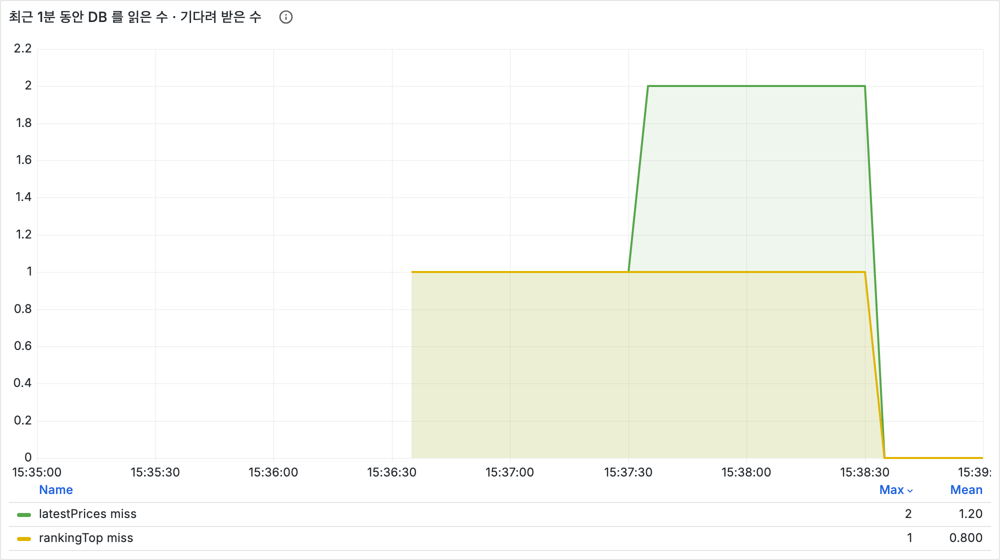

*그림 8-1. 끈 상태. 15:37:30 틱에서 가격 캐시를 2번 읽었다(동시에 놓친 두 요청). 첫 폭주(15:35:30)는 지표가 처음 생긴 순간이라 이 패널(1분 전과의 차이)에 나오지 않는다.*

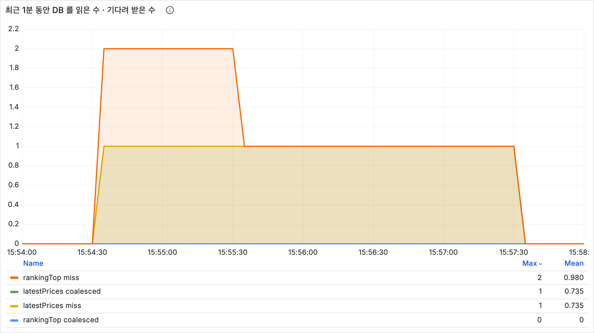

*그림 8-2. 켠 상태. 틱마다 가격 캐시 읽기는 1번, 기다려 받은 수(coalesced)가 1. 첫 폭주의 순위 2번은 동시 놓침이 아니다. 준비 단계에서 찍은 스냅샷을 처음 읽은 것(1)과 1초 뒤 새 스냅샷을 읽은 것(1)이다.*

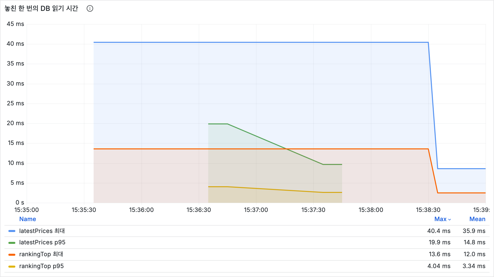

*그림 8-3. 놓친 한 번이 DB 에서 읽는 시간. 가격은 보통 10~20 ms(p95), 최대 40 ms. 순위는 p95 4 ms, 최대 14 ms. 최대(파랑·주황)는 Micrometer 가 약 2분간 기억하는 값이라 평평하게 이어진다. 이 시간 동안 도착한 같은 키 요청이 함께 놓친다.*

### 해석

- **스탬피드는 있다. 하지만 이 규모에서는 작다.** 5분에 한 번 10~40 ms 쿼리가 1번 더 도는 정도다.
- **지연 차이(23.8 → 8.3 ms)를 single-flight 덕이라고 하지 않는다.** 캐시를 거치지 않는 주문까지 4배 빨라졌기 때문이다. 이 차이는 서버 상태(steal 등)의 변동으로 본다. single-flight 의 효과로 말할 수 있는 것은 **틱마다 DB 읽기 1~2번 → 1번**뿐이다.
- **결정: 운영에서 켠다.** 손해가 보이지 않았고(지연·실패 0), 참가자가 늘어 읽기가 느려지면 동시 놓침이 커진다(P6). 앞사람을 기다리는 시간은 2초로 묶었고, 실패·초과면 직접 읽는다. 앞사람이 멈춰도 따라 멈추지 않는다.
- **한계**: 묶음은 서버 한 대 안에서만이다. 서버가 N대면 틱마다 최대 N번 읽는다(그래도 요청 수보다 훨씬 적다).

### 덤으로 찾은 것: 배포 직후 첫 몰림 (콜드 스타트)

single-flight 를 켜려고 재배포한 직후(앱 시작 15:45:47) 바로 측정했더니 첫 폭주 10초가 크게 느렸다. p95 약 0.5초, 최대 1.65초, 커넥션 대기 101, CPU 99%. 두 번째 폭주부터는 정상이었다. 9분 뒤 같은 설정으로 다시 재니 정상이었다(위 표의 "켬").

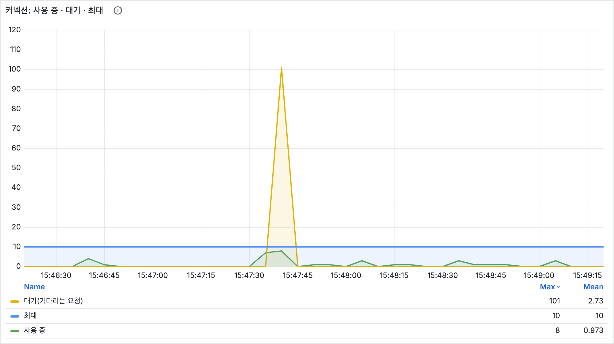

*그림 8-4. 앱 시작 1분 43초 뒤 첫 폭주(15:47:30)에서 커넥션 대기가 101까지 솟았다가 바로 0으로 돌아왔다.*

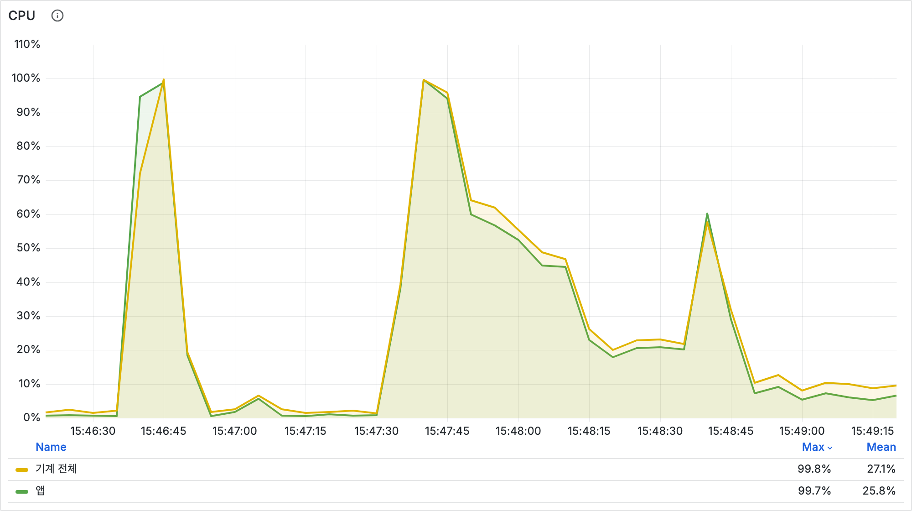

*그림 8-5. 같은 순간 CPU 99%. 막 뜬 JVM 은 코드를 아직 최적화(JIT 컴파일)하지 못해 같은 요청에 CPU 를 더 쓴다. 그래서 처리가 밀리고 커넥션 대기가 쌓였다.*

- **원인**: JVM 웜업. single-flight 와는 관계없다(데워진 뒤 같은 설정은 정상).
- **영향**: 배포하자마자 장 시작·틱 경계 같은 몰림이 오면 그 10초 동안 느리다.
- **다음 사례 후보**: 트래픽을 받기 전에 주요 API 를 미리 몇 번 불러 데우기(헬스 체크가 웜업 뒤에 "준비됨"이 되게), 또는 몰림 시각을 피해 배포하기.

### 정리: 이 사례에서 한 일

1. **가설**: 버전 키는 틱 경계에 한꺼번에 바뀐다 → 동시 놓침.
2. **재현 도구**: 고정 시계로는 재현이 안 됨 → 5배속 시계, 틱 경계를 steal 과 비켜 30초에.
3. **측정**: 틱마다 DB 읽기 1~2번, 한 번 10~40 ms → 작은 문제라고 수치로 판단.
4. **해결과 비교**: single-flight 를 설정으로 켜고 끄며 같은 이미지로 비교 → 1번으로. 지연 개선은 다른 변동이라 효과로 세지 않음.
5. **새로 찾은 문제**: 재배포 직후 첫 몰림이 느림(JVM 웜업).

## 9. 콜드 스타트와 데우기 (2026-11-14 18:07·18:15, EC2)

### 현상과 원인

8절에서 재배포 직후 첫 몰림이 느린 것을 봤다. 원인을 추측하지 않고 지표로 좁혔다.

- **JIT 컴파일 시간**(`jvm_compilation_time_ms_total` 의 초당 증가): 첫 폭주 동안 초당 1.8초. t3.micro 의 코어 2개 중 1.8개를 컴파일러가 썼다.
- **커넥션 풀**: 이미 10개가 다 열려 있었다 → "커넥션을 새로 만드느라"가 아니다.
- **클래스 로딩**: 150개 늘었을 뿐이다 → 주원인이 아니다.

### 해결: 준비되기 전에 데우기

`WarmupRunner` 는 앱이 뜬 뒤 "준비됨(readiness)"이 켜지기 전에, 진행 중인 대회의 참가자 한 명으로 자기 자신에게 조회 5종을 4개 스레드로 20초 보낸다. 읽기만 하고 주문은 넣지 않는다. 그동안 `/actuator/health` 가 UP 이 아니라서 도커 헬스 체크와 `deploy.sh` 는 데우기가 끝나야 성공한다.

### 측정: 같은 이미지, `LEAGUE_WARMUP` 만 바꿔서

| 첫 폭주(초당 480건, 10초) | 데우기 끔 (18:07) | 켬 (18:15) |
|---|---|---|
| 앱 시작 → 첫 폭주 | 17:59:08 → 18:07:20 무렵 (**8분 놀다가**) | 18:14:55 → 18:16:05 |
| JIT 에 쓴 코어 | 1.5~1.9 | 약 1.1 |
| 커넥션 대기 최대 | **53** | **0** |
| 폭주 구간 p95 / 최대 (k6, 3번 폭주 전체) | **282.4 ms / 1.78 s** | **18.2 ms / 149 ms** |
| 실패 · 불변식 위반 | 0 · 0 | 0 · 0 |

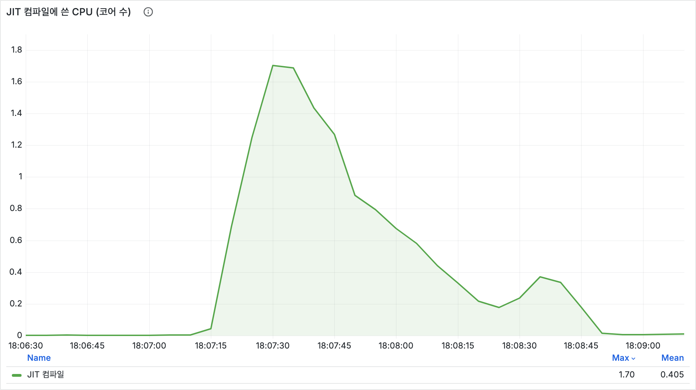

*그림 9-1. 데우기 끔. 8분 동안 놀던 JVM 이 첫 폭주(18:07:20)를 받자 JIT 가 코어 1.9개를 썼다.*

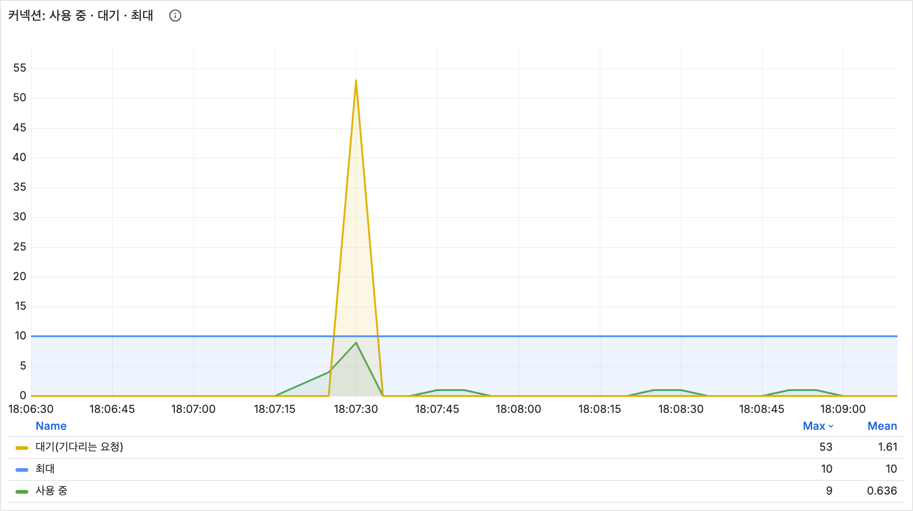

*그림 9-2. 같은 순간 커넥션 대기 53. 요청을 처리할 CPU 가 모자라 커넥션을 쥔 채 늦어진 것이다.*

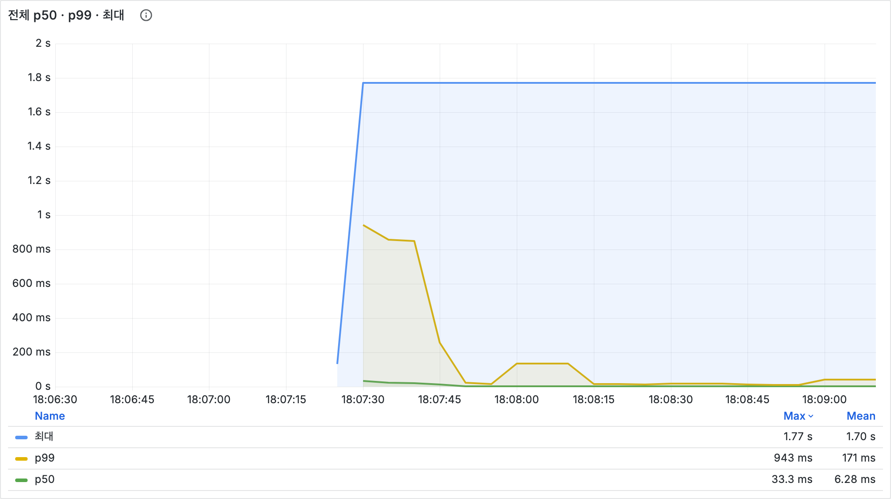

*그림 9-3. 첫 폭주의 p99 943 ms, 최대 1.77 s. 15초 뒤 두 번째 구간부터 수십 ms 로 돌아온다.*

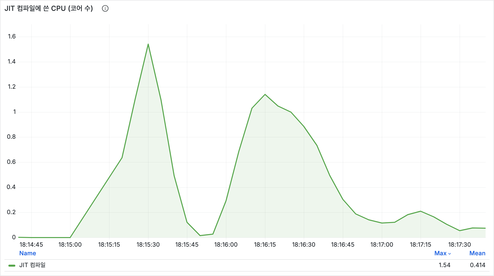

*그림 9-4. 데우기 켬. 첫 산(18:15:00~18:15:40)이 데우기다. 사용자 요청이 오기 전에 컴파일을 끝냈다. 둘째 산(18:16:00~)은 k6 준비 단계(사용자 1,000명 만들기·참가, 데우지 않은 쓰기 경로)와 첫 폭주다. 여전히 코어 1개쯤을 쓰지만 끈 상태의 1.9개보다 여유가 있다.*

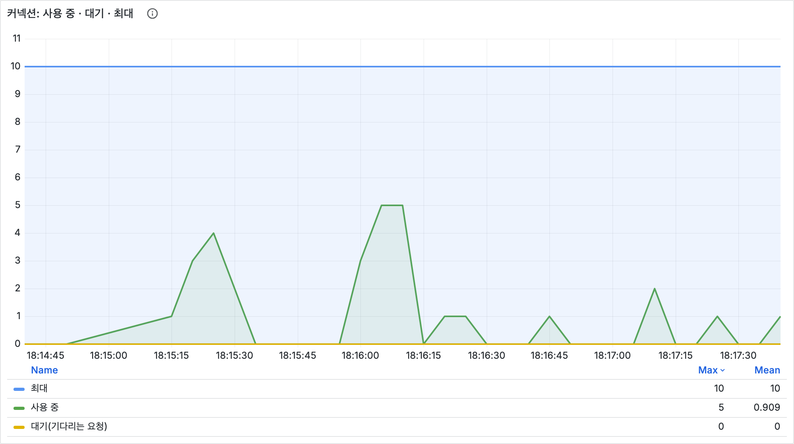

*그림 9-5. 켠 상태에서는 첫 폭주에도 커넥션 대기가 0이다.*

### 해석

- **JVM 은 시간이 지나도 데워지지 않는다.** 끈 상태는 앱이 뜬 뒤 8분을 놀았는데도 콜드였다. JIT 는 "자주 실행된 코드"를 컴파일하므로 요청이 와야 데워진다. 그래서 문제는 "배포 직후"가 아니라 **"재시작 뒤 첫 몰림"**이다. 장 시작 전에 배포해 두어도 9시 첫 몰림은 콜드다.
- **데우기가 첫 폭주의 꼬리를 없앴다.** 커넥션 대기 53 → 0, 폭주 p95 282 → 18 ms. 이 차이는 데우기 덕이라고 말할 수 있다. 8절과 달리 캐시와 무관한 주문까지 같이 좋아진 것이 아니라, 원인 지표(JIT 코어 수)가 함께 줄었기 때문이다.
- **같은 콜드라도 아픈 정도가 다르다.** 8절의 첫 측정(15:35)도 첫 폭주에서 JIT 가 코어 1.4개를 썼지만 커넥션 대기까지 번지지 않았다. 여유가 조금만 있어도 넘어가고, steal 등이 겹치면 번진다.
- **한계**: 데우기는 조회만 한다. 주문 접수·사용자 만들기 같은 쓰기 경로는 첫 사용자가 데운다(그림 9-4 의 둘째 산). 서버가 한 대라 재시작 중 잠깐 끊기는 것은 데우기와 무관하게 남는다(여러 대·무중단 배포가 필요).

### 정리: 이 사례에서 한 일

1. **현상**: 재배포 뒤 첫 몰림 10초 동안 커넥션 대기 53~101, p99 약 1초(8절에서 덤으로 발견).
2. **분석**: JIT 코어 수 1.8 ↔ 커넥션 풀(이미 가득)·클래스 로딩(+150) 배제. 8분 놀아도 콜드 → 시간이 아니라 요청이 데운다.
3. **해결**: readiness 전에 자기 자신에게 조회를 보내는 데우기. 헬스 체크가 데우기를 기다리게.
4. **재측정**: 같은 이미지, 설정만 바꿔 커넥션 대기 53 → 0, 폭주 p95 282 → 18 ms.
5. **곁가지로 고친 것**: 같은 이미지 재배포 때 `.env` 변경이 반영되지 않던 `deploy.sh` → 항상 새로 띄우게(`--force-recreate`).

---

## 10. P6 참가자 10만 명의 순위 스냅샷 (2026-11-14~15, EC2 + RDS)

### 현상

순위 스냅샷은 5분마다 대회 참가자 전원의 총자산을 한 문장(`INSERT … SELECT`)으로 계산해 순위 표에 넣는다. 참가자를 SQL 로 바로 만들어(`deploy/sql/p6-seed.sql`, 1명당 보유 약 5종목) 관리자 스냅샷 API 로 쟀다.

| 참가자 | 1만 | 5만 | 10만 |
|---|---|---|---|
| 스냅샷 한 장(쓰기 포함) | 0.70초 | 2.63초 | 5.75초 |

참가자 수에 거의 비례한다(1명당 53~70 µs). 5분 주기 안에는 들어가지만, 그동안 DB CPU 를 쓰고 커넥션 하나를 쥔다.

### 첫 가설: 낡은 통계 → 나쁜 실행 계획 (반만 맞았다)

- **EXPLAIN 에서 본 것**: 플래너가 새 대회의 상장 종목을 **1개**로 예상했다(실제 24개). 그래서 보유 48만 행마다 종목을 다시 훑는 중첩 루프를 골랐다(`loops=480000`).
- **원인**: 새 대회의 상장 24줄은 자동 ANALYZE 기준(50줄 + 10%)에 못 미친다. 통계에 없는 `contest_id` 는 "거의 없음 = 1줄"로 잡힌다.
- **확인**: `analyze contest_listings` 만 하고 같은 문장을 돌리니 해시 조인, 3,163 → 1,543 ms.
- **해결**: 대회를 시작할 때 `analyze contest_listings`(`ContestService.start`, 테스트 `ContestStatisticsTest`).

그런데 고친 이미지에서 옛 경로(SQL 로 만든 대회 = 통계 없음)와 새 경로(API 로 시작 = ANALYZE)를 번갈아 다섯 번씩 재니 **차이가 없었다**.

| 스냅샷 API | 1 | 2 | 3 | 4 | 5 |
|---|---|---|---|---|---|
| 옛 경로 | 5.69 | 5.76 | 7.94 | 4.98 | 6.21초 |
| 새 경로 | 6.13 | 6.53 | 5.70 | 5.53 | 6.12초 |

옛 경로도 여전히 1줄로 예상했지만, 플래너는 두 경로 모두 해시 조인을 골랐다. 처음 근거는 한 쌍뿐이었고, 1,543 ms 는 같은 조건의 흔들림(1.1~2.8초) 안이었다. 그래서 **"ANALYZE 로 절반이 됐다"는 결론을 버렸다.** 확인된 것은 "예상 줄 수가 실제와 맞게 된다"까지다.

### 두 번째: 시간이 실제로 어디에 가나

읽기가 약 2초면 나머지 3~4초는 쓰기다. 앱과 같은 문장을 `EXPLAIN (ANALYZE, WAL)` 로 돌리고 ROLLBACK 했다(`deploy/sql/p6-write.sql`).

| 10만 줄 쓰기 | 시간 |
|---|---|
| 읽기(순위 계산까지) | 1.0~1.3초 |
| 줄 넣기 + 인덱스 2개 | 0.6~1.5초 |
| **외래 키 검사: 스냅샷**(10만 번) | **1.6~1.8초** |
| **외래 키 검사: 참가자**(10만 번) | **1.2~1.4초** |
| 합계 | 4.5~6.0초 (WAL 25MB) |

외래 키 검사는 줄마다 참조 대상을 찾아 `FOR KEY SHARE` 로 잠근다. 스냅샷 쪽은 **같은 트랜잭션에서 방금 만든 한 줄**을 10만 번 확인했다. 같은 트랜잭션 안에서 외래 키만 빼고 번갈아 쟀다(`deploy/p6-write.sh`).

| | 1회 | 2회 | 3회 |
|---|---|---|---|
| 외래 키 있음 | 4.60초 | 5.97초 | 4.80초 |
| 외래 키 없음 | 2.69초 | 2.91초 | 2.06초 |

세 쌍 모두 같은 방향이고 차이(약 2.6초)가 흔들림보다 크다.

### 해결: 순위 줄의 외래 키를 빼고, 불변식 검사로 대신 지킨다

- **V5 마이그레이션**: `ranking_entries` 의 외래 키 2개를 뺐다.
- **빼도 되는 이유**: 이 표의 줄은 한 문장만 만든다. 그 문장은 참가자 표에서 직접 읽고, 같은 트랜잭션에서 만든 스냅샷 id 로 넣는다. 지우는 쪽은 줄을 먼저, 스냅샷을 나중에 한 트랜잭션에서 지운다. 외래 키가 막아 줄 경우가 구조상 없다.
- **대신 지키는 것**: 불변식 검사에 `RANKING_ENTRY_REFS`(가리키는 참가자가 없거나 다른 대회인 순위 줄)를 넣었다. 테스트로 정상 0건, 없는 참가자를 가리키는 줄을 넣으면 1건인 것을 확인했다.
- 돈이 오가는 표(원장·주문·보유)의 외래 키는 그대로 둔다.

### 재측정 (V5 배포 뒤, 같은 스크립트)

| 스냅샷 API | 외래 키 있음(V4, 5회) | 외래 키 없음(V5, 2회) |
|---|---|---|
| 옛 경로(통계 없음) | 4.98~7.94초 | 3.36 · **5.25**초 |
| 새 경로(시작할 때 ANALYZE) | 5.53~6.53초 | 2.94 · 3.08초 |

- **쓰기 쪽은 효과가 그대로 나왔다**: 5~6초 → 약 3초.
- **옛 경로 5.25초는 첫 가설의 나쁜 계획이 다시 나온 것이다.** 그 회차의 EXPLAIN 은 `Nested Loop Left Join` 으로 48만 행을 돌았다(같은 회차 새 경로는 해시 조인, 3.08초). 옛 경로 7번 중 1번, 새 경로는 7번 중 0번이었다. 통계 상태에 따라 가끔 나오고, ANALYZE 가 있으면 나오지 않는다. 그래서 ANALYZE 는 "평소엔 차이 없고, 걸리면 2초를 막는 보험"이라고 말한다.
- **한계**: V5 뒤는 두 번뿐이다. 동시 부하 중 영향은 다음 소절.

### 곁가지로 나온 것

- **정리 SQL 이 끝나지 않았다.** 참가자 26만 명을 지우자 외래 키 검사가 줄마다 순위 표 전체를 훑었다. `ranking_entries` 의 기본 키가 `(snapshot_id, participant_id)` 라 `participant_id` 만으로는 인덱스를 못 탄다. 지우는 동안만 인덱스를 만들어 40초에 끝냈다(V5 뒤에는 순위 표 쪽 검사 자체가 없다).
- **붙여 넣은 명령이 사라졌다.** `psql.sh` 는 `docker run -i` 라 실행 중에 터미널 입력을 가져간다. 측정 스크립트 안의 호출에 `</dev/null` 을 붙이고, 긴 명령은 스크립트 파일로 올려 돌렸다.

### 동시 부하 중 스냅샷: 다른 요청이 얼마나 늦어지나 (2026-11-15~16)

평소 부하(k6 steady, 초당 120건) 중에 10만 명 스냅샷을 찍었다(`deploy/p6-concurrent.sh`). 앱의 초당 요청 수로 부하 시작을 스스로 알아채고, 기준선 60초 뒤 40초 간격으로 찍는다. 1초마다 `pg_stat_activity` 를 같이 기록했다.

| 구간 | 사용자 p99 | 커넥션 대기(최고) |
|---|---|---|
| 평소 | 10~20 ms | 0 |
| 스냅샷 (6.0초) | 4,622 ms | 105 |
| 스냅샷 (6.6초) | 3,309 ms | 95 |

스냅샷 순간 앱 세션 10개(풀 전부)가 DB 에서 실행 중이었고, `IO:WALSync`·`LWLock:WALWrite`(커밋이 WAL 을 내리려고 줄섬)와 `IO:BufFileRead/Write`(정렬·해시가 work_mem 4MB 를 넘쳐 임시 파일)가 보였다. RDS CPU 크레딧은 넉넉했다(220~225). 1분 평균 지표로는 3초짜리 일이 보이지 않는다.

**시도 ①: 스냅샷 트랜잭션에만 `work_mem` 32MB + `synchronous_commit = off` — 더 나빠져서 되돌렸다.** 같은 부하 안에서 끔 → 켬 → 끔 → 켬 으로 번갈아 찍었다(관리자 API `?tuning=`).

| 스냅샷 | 설정 | 걸린 시간 | 사용자 p99(최고) | 커넥션 대기(최고) | 초당 요청(최저) |
|---|---|---|---|---|---|
| 1 | 끔 | 7.8초 | 2,249 ms | 0 | 100 |
| 2 | 켬 | 14.6초 | 9,509 ms | 190 | 3 |
| 3 | 끔 | 8.1초 | 335 ms | 25 | 113 |
| 4 | 켬 | 13.0초 | 3,208 ms 이상 | 188 | 81 |

- 켠 두 장 모두 풀이 바닥났고 처리량이 무너졌다. 켠 구간의 DB 세션은 7~9개가 활성인데 대기 종류가 없었다 = 기다리는 게 아니라 CPU 에서 돌고 있었다. 1초마다 찍는 감시 쿼리마저 8초 밀렸다.
- 부하 없이 같은 INSERT 를 EXPLAIN ANALYZE 로 비교했다(`p6-write.sh 2 100000 wm`). 계획은 같고(해시 조인 3개 → HashAggregate → 정렬 → rank), 32MB 에서는 임시 파일이 사라졌다(HashAggregate Batches 5 → 1, Disk 20MB → 0, 정렬 external merge → quicksort). 그런데 시간은 기본 2.06 · 2.60초, 32MB 2.50 · 2.89초로 **줄지 않았다.** 넘친 양이 20MB 뿐이라 임시 파일은 병목이 아니었다.
- 해석: 임시 파일과 WAL 대기는 원인이 아니라 증상이었다. 대기가 사라지자 스냅샷이 CPU 를 쉬지 않고 쥐었고, vCPU 2개짜리 DB 에서 다른 쿼리가 차례를 못 받았다. 두 설정을 따로 재지는 않았다. 둘 다 "기다림을 없애는" 방향이라 이 결과에서는 함께 뺐다.
- 결론: 코드를 되돌렸다. 기록이 두 쌍뿐이지만 방향이 둘 다 같고 차이(풀 대기 0~25 vs 190)가 흔들림보다 크다. 같은 결과가 28단계의 단독 측정(32MB 의 효과는 흔들림 안)과도 맞는다.

### 정리: 이 사례에서 한 일

1. **현상**: 10만 명 스냅샷 5.75초, 참가자 수에 비례.
2. **분석 1**: 예상 1줄 → 중첩 루프. 통계를 고쳤지만 다섯 쌍 재측정에서 차이가 없어 결론을 고쳤다.
3. **분석 2**: 시간을 부분별로 쪼개 외래 키 검사가 절반(2.7~3.0초)임을 찾았다. 빼고 세 쌍 비교로 확인.
4. **해결**: 순위 줄 외래 키 제거(V5) + 불변식 검사로 대신 지킴. 통계 ANALYZE 는 보험으로 유지.
5. **재측정**: 5~6초 → 약 3초. 그 와중에 나쁜 계획이 한 번 재현돼 ANALYZE 의 쓸모도 확인했다.
6. **동시 영향**: 부하 중 스냅샷은 사용자 p99 를 3~5초로 올리고 풀을 바닥낸다. 임시 파일·WAL 대기를 없애는 설정은 오히려 CPU 독점을 키워 되돌렸다. 다음은 한 번에 덜 쥐게 나누는 쪽이다.

---

## 그림 다시 뽑기

```bash
monitoring/up.sh <대상>                                   # Grafana 가 떠 있어야 한다. 데이터는 30일 남는다
node monitoring/capture.mjs <이름> <시작초> <끝초> [패널 id ...]   # → docs/img/<이름>-p<id>.png
#   기본 패널: 5 p95(API별) · 4 응답 상태 · 8 커넥션 · 10 커넥션 쥔 시간 · 14 CPU · 6 p50/p99
#   시작·끝은 러너가 마지막에 출력하는 Grafana 링크의 from/to(밀리초)에서 뒤 세 자리를 뺀 값
```
